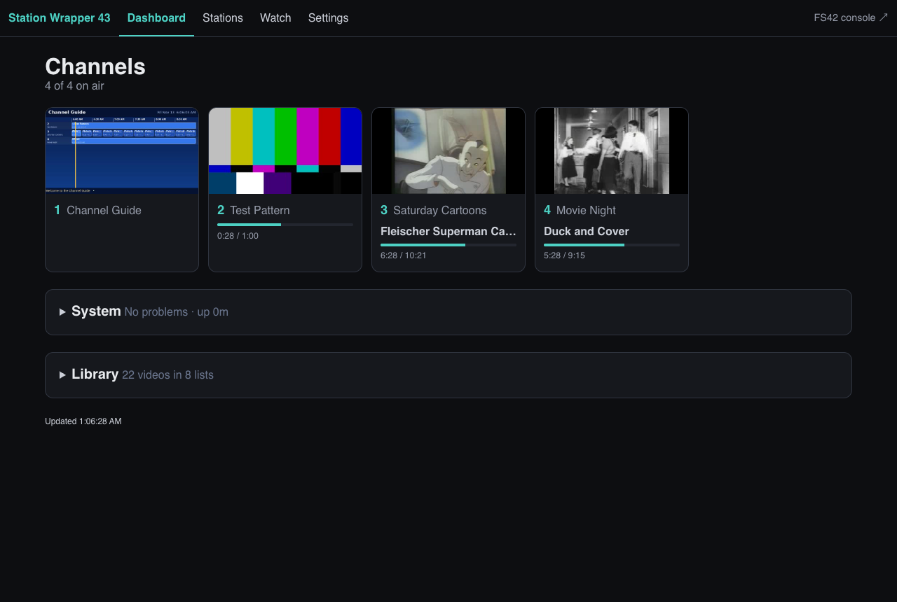
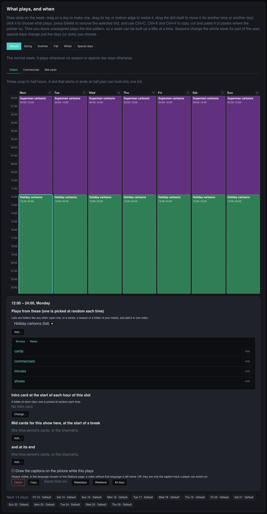
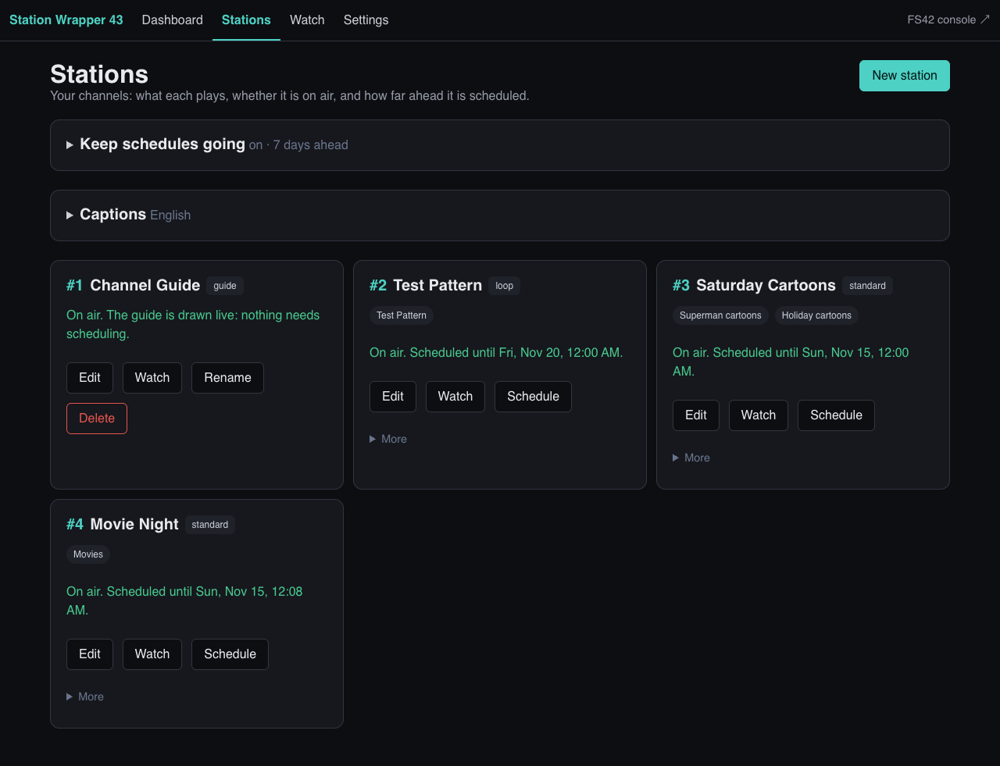
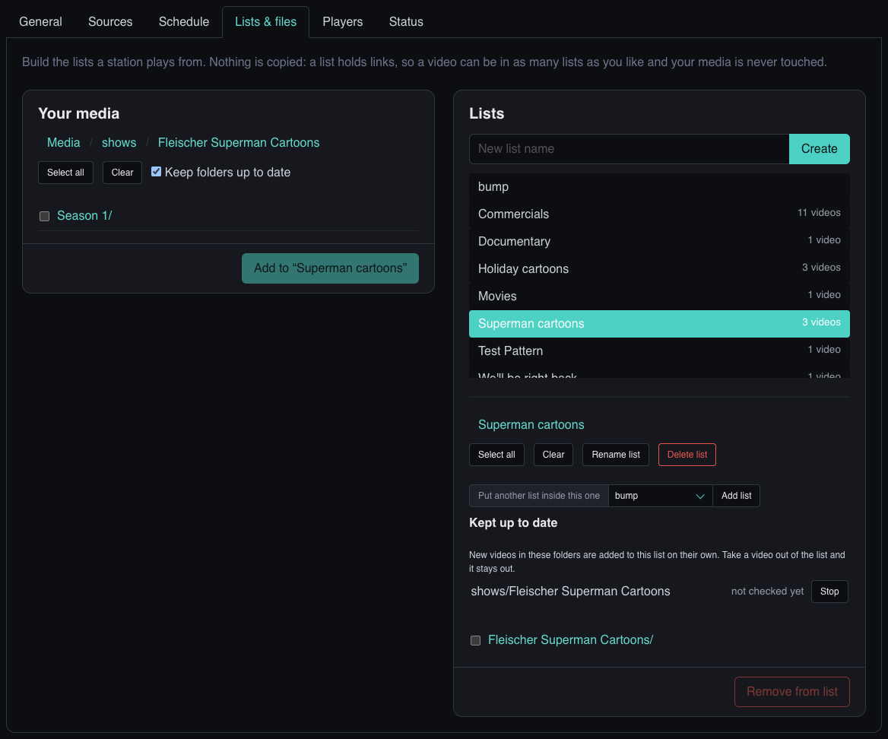
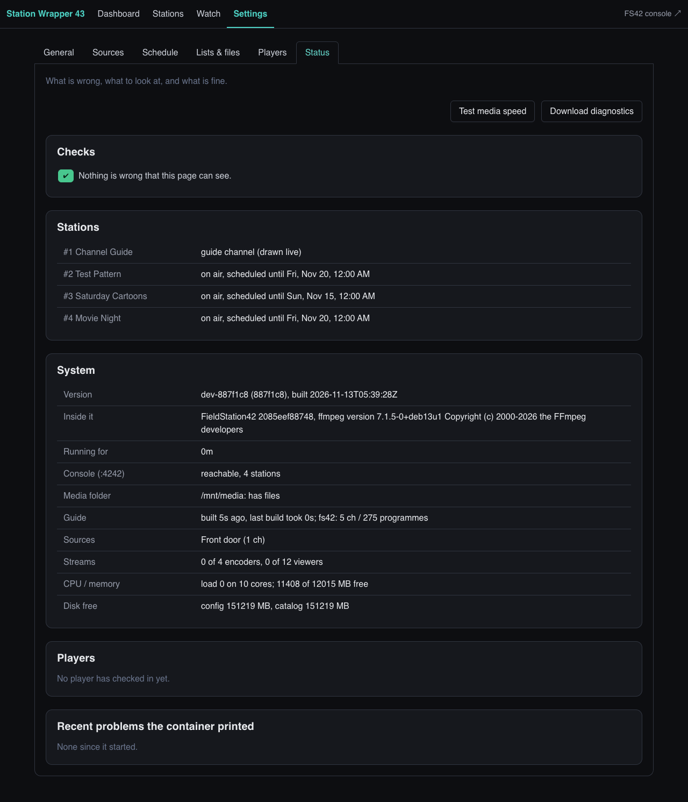
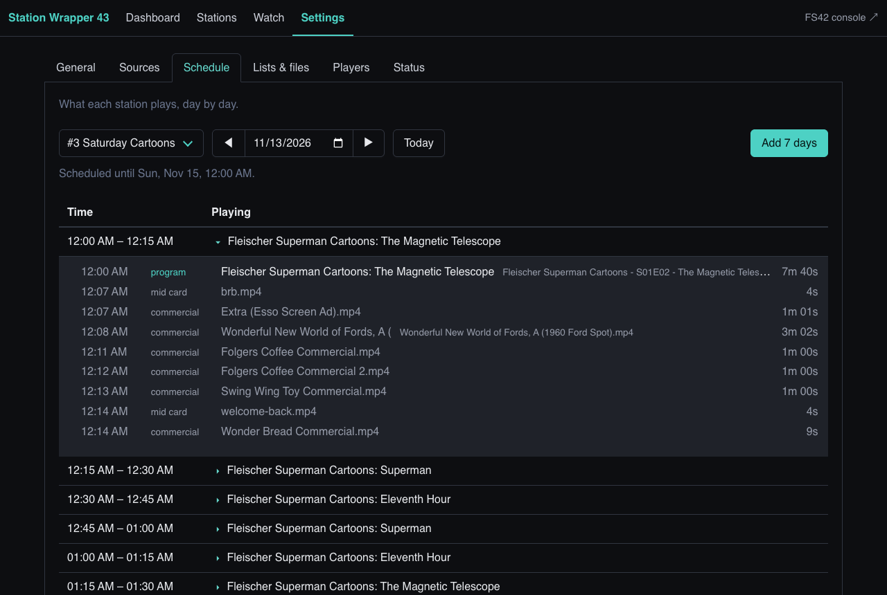
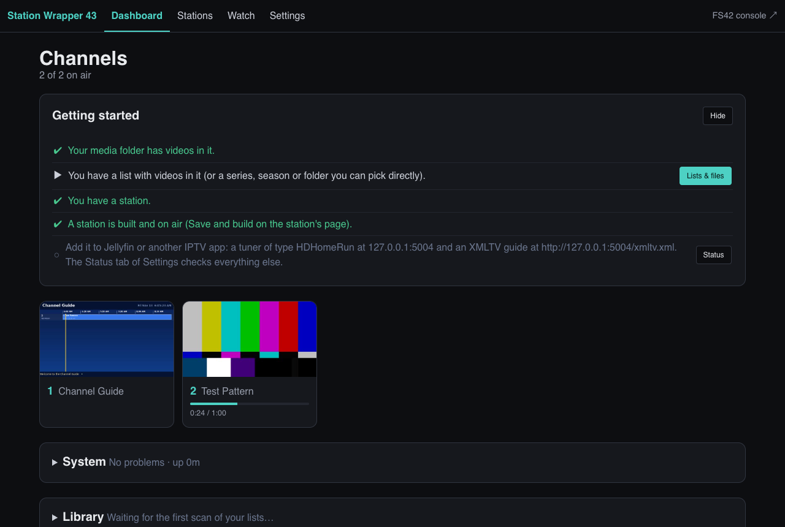
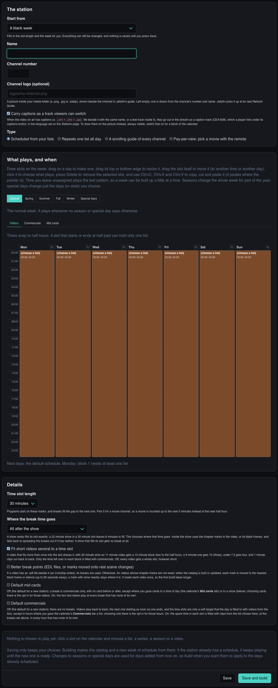
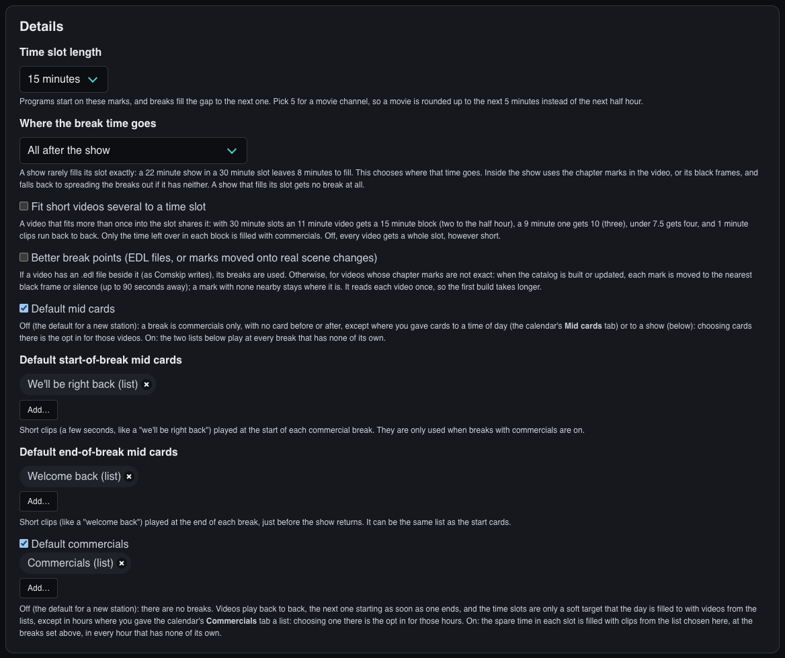

# Station Wrapper 43

Make your own TV channels out of your own videos. **Station Wrapper 43** runs [FieldStation42](https://github.com/shane-mason/FieldStation42) in one Docker container and adds the pages to run it: a dashboard, a week calendar for each channel, a TV guide channel, a browser player, and an IPTV tuner that Jellyfin, Plex, VLC or TVHeadend can use.

> **Built on [FieldStation42](https://github.com/shane-mason/FieldStation42)** by shane-mason and its contributors, which does all the scheduling and cataloguing. It is run here unmodified; Station Wrapper 43 is the container, pages and tuner around it. Thank you to its authors.



## What you get

- **Channels that run all day by themselves.** Draw a week on a calendar (cartoons in the morning, movies at night, a different lineup in summer or on a holiday), and the schedule builds and keeps itself topped up.
- **Breaks like real TV, when you want them.** Commercials and start/end "we'll be right back" cards, by default, by time of day, or per show. Or no breaks at all: videos play back to back.
- **A scrolling TV guide channel** drawn live, with every channel and what is on.
- **One lineup for everything.** Your channels, an antenna tuner, a playlist and a camera in one HDHomeRun-style lineup and one guide, with synopsis, pictures and channel logos.
- **An HDHomeRun's guide for Jellyfin.** Jellyfin cannot read an HDHomeRun's schedule itself. The container reads SiliconDust's guide for the antenna and serves it as XMLTV (listings, logos, episode details), so Jellyfin needs no Schedules Direct account. It is SiliconDust's own service, so how far ahead it lists depends on their answer for your device (a unit without their DVR subscription usually gets a short window), and it covers over-the-air in the US and Canada.
- **A weather channel with one switch.** A 1990s WeatherStar 4000 forecast with the music ([WeatherStar 4000+](https://github.com/netbymatt/ws4kp) drawn by [ws4channels](https://github.com/rice9797/ws4channels)). `COMPOSE_PROFILES=weather` in `.env` adds it; type a ZIP code on the Settings page, change it any time, and the channel follows within a minute. United States forecasts, amd64 machines.
- **Easy to start.** A *Getting started* card, a **Make me a channel now** button, and templates for a cartoon channel, a mainstream channel, a movie channel and a loop. Or hand the job to an AI agent with [this prompt](docs/AGENT-PROMPT.md).
- **Your media is never touched.** It is mounted read-only; a list is only links.

### Added in this fork

- **A player PC for a real TV (client mode).** The same image with `FS42_ROLE=client` turns any spare PC (amd64 or arm64) into a set-top box: it copies the server's schedule about once a minute and plays it with mpv straight to the screen (HDMI, VGA, or an adapter to a CRT), with no desktop. It shows the same thing as Emby or Jellyfin at the same moment. `FS42_SCREEN=crt` crops widescreen to fill a 4:3 set; the server's **Status** page lists every player and warns when one falls behind. See [Client Mode Player](https://github.com/austincnunn/station-wrapper-43/wiki/Client-Mode-Player).
- **Pay-per-view channels.** A poster menu of a movie folder: page through with the remote, press Enter, and the movie plays from the start. Made on the Stations page; played by client-mode players (it is left out of the tuner's lineup).
- **Guide details from Emby or Jellyfin.** Set `MEDIA_SERVER_URL` and `MEDIA_SERVER_API_KEY` and the guide gets each video's real title, episode, synopsis and poster. Without an `.nfo`, titles fall back to the folder and file name; Kodi `<musicvideo>` `.nfo` files are read too.
- **A guide that reads like TV for music video channels.** Channels of short videos are listed in half-hour blocks named after the channel, with the song list in the description, instead of hundreds of three-minute entries. Loop and packed blocks list each video.
- **Guide channel options**: picture shape (16:9 or 4:3) and text size.
- **Live TV audio fix**: Emby no longer starts audio up to a minute late after tuning.
- **Images for amd64 and arm64**, built against upstream FieldStation42's newest commit and only pushed after its schema tests and a smoke test pass.
- **Extras**: a nightly backup script, the manual remote-player scripts, and a YouTube channel (YouTube's TV app in a container, cast to from a phone). See [extras/](extras/README.md).

| | |
|---|---|
|  |  |
| The guide channel, drawn live: your channels and an antenna tuner's, with the real listings | A week on the calendar, with the one browser for what plays |

## Quick start

```
mkdir tv && cd tv
curl -LO https://raw.githubusercontent.com/austincnunn/station-wrapper-43/main/docker-compose.yml
docker compose up -d
```

That is all of it: no settings file, no setup script. It makes two folders beside the compose file: `data` (its own files; keep it on a local disk, not a network share) and `media`. Put videos in `media`, or, if they are somewhere else, say where in a file called `.env` beside the compose file and run `docker compose up -d` again:

```
FS42_MEDIA_ROOT=/mnt/media
```

Every other setting is optional and listed in [.env.example](.env.example); most can be changed on the dashboard's Settings page instead (General, under Advanced).

### Or let the installer do it

On a Linux machine, one line sets up a server or a client-mode player PC:

```
curl -fsSL https://raw.githubusercontent.com/austincnunn/station-wrapper-43/main/install.sh | bash
```

It asks a few questions, shows what it will do, and then installs Docker if it is missing, can mount your media share (SMB or NFS, read-only, at every boot), writes `.env`, and starts the container. It asks whether your videos come from an Emby or Jellyfin server, and skips the media share if they all do. On an ordinary PC it offers the weather channel and asks for your ZIP code. It can also set a timer that checks for a new version daily or weekly and installs it. It is safe to run again, and every answer can be given in the environment instead (the list, and what it changes on the machine, is in the [reference](docs/REFERENCE.md#the-installer)).

Want a weather channel too? Put `COMPOSE_PROFILES=weather` in `.env` and run `docker compose up -d` again: two more small containers start and a Weather channel appears (channel 3, or the next free number). Type your ZIP code on the dashboard's **Settings** page (the **Sources** tab, under Weather channel) and it shows your forecast. It is off by default because it needs an amd64 (ordinary PC) machine, not a Raspberry Pi, takes about one CPU core and 1 GB of memory all day, and covers the United States only.

Prefer to write the compose file yourself, with only some media folders mounted? [docker-compose.sample.yml](docker-compose.sample.yml) is a complete one.

Open `http://<host>:5004`. A new install already has a Channel Guide on channel 1 and a Test Pattern on channel 2; press **Make me a channel now** (or **New station**) to make the first real one. The [QUICKSTART](QUICKSTART.md) has the first ten minutes, and the [reference](docs/REFERENCE.md) has the rest.

### Try it with public-domain videos

No media yet? `scripts/fetch-demo-media.py` downloads a small library the Internet Archive marks as public domain (a Fleischer *Superman* cartoon series, holiday cartoons, a civil-defence short, vintage commercials) with `.nfo` files, posters and "we'll be right back" cards:

```
python3 scripts/fetch-demo-media.py --dest media      # about 300 MB; --features adds two full films
```

Run it beside the compose file (it needs a clone of this repository for the script) and the videos land in `media`, where the container looks. Where each file came from, and its license mark, is in `media/SOURCES.md`.

## A short tour

| | |
|---|---|
|  |  |
| **Stations**: one card per channel, build and keep it going | **Settings → Lists & files**: browse your media, make lists, or use a series directly |
|  |  |
| **Settings → Status**: what is wrong first, with a button to fix it | **Settings → Schedule**: what plays when, down to each file in a break |
|  |  |
| **First run**: the Getting started card and a channel in one click | **New station**: start from a template, then change anything |



### In Jellyfin

Add the container as an HDHomeRun tuner and its `/xmltv.xml` as the guide; your channels sit beside an antenna tuner's, with logos, programme names and episode titles.

1. **Live TV → Tuner Devices → Add → HDHomeRun**: `http://<container host>:5004`.
2. **Live TV → TV Guide Data Providers → Add → XMLTV**: `http://<container host>:5004/xmltv.xml`.
3. **An antenna tuner set to *guide only*** (Settings → Sources) brings only its listings into this guide; its video still comes from the tuner. So also add the tuner itself as a **second HDHomeRun tuner device** in Jellyfin, at its own address (`http://<tuner address>`), for its channels. It needs no guide provider of its own: its listings are already in the container's XMLTV. Set it to *proxy* instead and the container carries its channels and none of this is needed.
4. **Refresh Guide Data**, then check each tuner's channels are mapped.


## How it works

```
                  ┌────────────────────── one container ─────────────────────────────────┐
 your media ─────>│ console :4242  ──writes──>  fs42_fluid.db  ──reads──>  tuner :5004    │──> browser, Jellyfin, VLC
 (read-only)      │ (FieldStation42)                (sqlite)               (ffmpeg, mpegts)│
                  │ + sync (optional): keeps a pool of symlinks to your media current     │
                  └───────────────────────────────────────────────────────────────────────┘
```

A small supervisor runs these and keeps them up (it restarts one that stops, tags each log line, and stops them cleanly). **console** is FieldStation42's web console, where catalogs and schedules are built. **tuner** reads the schedule, encodes each channel once with ffmpeg, and serves the dashboard, the player, the guide and the IPTV endpoints. `docker logs <container>` shows all of them. FieldStation42 itself is fetched unmodified from upstream when the image is built (its newest commit, or `FS42_REF`); its behaviour is adjusted at run time by `fieldstation42/console_launch.py`.

## Documentation

- [QUICKSTART](QUICKSTART.md): the first ten minutes.
- [Let an AI agent build your channels](docs/AGENT-PROMPT.md): a prompt to paste into Claude Code or a similar agent once the server is up. It looks at your library, proposes a lineup, and builds it after you say yes.
- [Wiki](https://github.com/austincnunn/station-wrapper-43/wiki): step-by-step guides. Setting up a server, making channels (including pay-per-view), a client-mode player PC that plays the same broadcast on its own TV, weather, block and YouTube channels, backups. Its scripts are in [extras/](extras/README.md).
- [Reference](docs/REFERENCE.md): the volumes and settings, the login, every page, sources and antenna tuners, breaks and mid cards, the YouTube conversion, the generator, updating FieldStation42.
- [Changelog](CHANGELOG.md), [Roadmap](ROADMAP.md), [Security](SECURITY.md), [Contributing](CONTRIBUTING.md), [Notices](NOTICE), [Releasing](docs/RELEASING.md).

## License

- **This project's own code** (the wrapper, dashboard, tools and scripts) is under the [PolyForm Noncommercial License 1.0.0](LICENSE): **free for personal use** (research, hobby projects, private entertainment, study) and for other noncommercial uses the license lists. **Commercial use needs a separate agreement with the author**: contact JamesM92 through this repository.
- **FieldStation42** (the scheduling engine, fetched from upstream when the image is built) is by shane-mason and is under the **Mozilla Public License 2.0**. It is included unmodified, with its own `LICENSE`. This project's license does not apply to it.
- Everything else in the image (ffmpeg, Python and its packages, mpegts.js) keeps its own license.
- This is a plain-language summary, not legal advice. The `LICENSE` file is what counts.

## CI/CD

Workflows live in `.github/workflows/` and need a runner labeled `ubuntu-latest` with Docker access.

| workflow | trigger | what it does |
|---|---|---|
| `ci.yml` | push to `dev`/`main`, PR to `main` | syntax checks, every test, the FieldStation42 contract against upstream's newest commit |
| `security.yml` | push to `dev`/`main`, PR to `main`, weekly | bandit on our code, a pip-audit of the pinned `requirements.txt`, a secret scan (detect-secrets), a Trivy scan of the repository (dependencies, secrets, the Dockerfile); a finding fails the run |
| `dev-image.yml` | push to `dev`/`main`, every Sunday, and on demand | builds the one image with upstream's newest FieldStation42 (or the `fs42_ref` asked for), runs the FieldStation42 contract and schema checks against it and the smoke test (`scripts/smoke-image.sh`), then pushes `:latest` and `:main-<short-sha>` from `main`, `:dev` and `:dev-<short-sha>` from `dev`; nothing is pushed if a check fails |
| `release-image.yml` | `v*` tag | builds, smoke-tests, then pushes `:<version>` and `:latest` |
| `codeql.yml` | GitHub only | GitHub code scanning |

Developer checks that need Docker: `scripts/e2e-breaks.py` (the break settings against the real engine), `scripts/e2e-seasons.py`, and `scripts/make-screenshots.py` (the pictures in `docs/images`). `scripts/preflight.sh` runs the CI checks and a throwaway image build before a push.

The image: `ghcr.io/austincnunn/station-wrapper-43` (one image, whatever you switch on); `FS42_TAG` picks `latest` (default), `main-<short-sha>`, `dev`, or a release version. Setup, once: no secret is needed: the workflow uses GitHub's own token.

## About how this was made

**This project was written with AI.** The code, tests and documentation were produced by an AI coding assistant ([Claude Code](https://claude.com/claude-code), from Anthropic), working to the direction of its owner, who decided what it should do, ran it against real media and a real HDHomeRun tuner, and reviewed and corrected the results. It has a large automated test suite and security scans (see above), and it has been run end to end in a container, but it has not had the long soak of a mature project, and a person did not read every line. Expect rough edges, back up your configuration before upgrading, and please [report what you find](https://github.com/JamesM92/station-wrapper-43/issues).

FieldStation42, which does the scheduling, is a separate project by its own authors and is fetched unmodified when the image is built.
